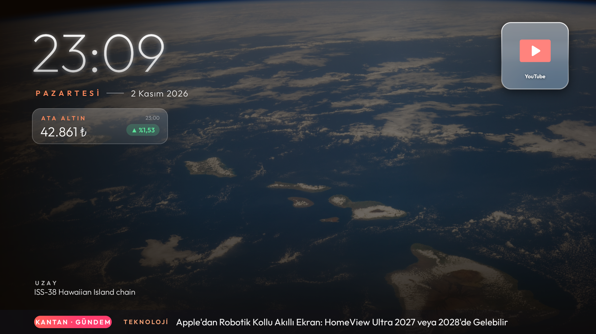

# Loop Home

Xiaomi TV Box S (2. nesil) için sade, hızlı, reklamsız bir ana ekran ve kutuyu adım adım
temizleyip kuran bir kurulum betiği.



- **Sonsuz döngülü 3x3 cam grid** — yön tuşlarıyla uygulamalar arasında kesintisiz gez
- **Arka plan fotoğrafları** — NASA/Wikimedia uzay fotoğrafları, kendi Unsplash anahtarınla doğa,
  mimari, hayvan fotoğrafları
- **Haber bandı, döviz/altın kartı, saat ve tarih**
- **Podcast rafı** ve kaldığı yerden devam eden oynatıcı; dinlerken ekranı karartma
- **Açık uygulamalar** (Home basılı tut) ve **tüm uygulamalar listesi** (atadığın bir kumanda tuşuyla, her yerden)
- **Uyku zamanlayıcısı**, gece modu (güneş batınca ekran yavaşça kararır), 5 dk boşta → uyku uyarısı
- Gizli menü: TV+ tuşunu basılı tut ya da ↑ ↑ ↓ ↓

## Hızlı kurulum

```bash
git clone <bu depo> && cd TV-LoopHome
./setup/setup.sh --dry-run   # önce dene, hiçbir şeyi değiştirmez
./setup/setup.sh
```

Ayrıntılar, gereksinimler ve sorun giderme: **[docs/KURULUM.md](docs/KURULUM.md)**

Kurulum her adımı sorar ve yaptığı her şeyi geri alma komutuyla kaydeder. Kutuda neyin neden
değiştiğinin tam listesi: [docs/SISTEM-DEGISIKLIKLERI.md](docs/SISTEM-DEGISIKLIKLERI.md).

## Bir yapay zekâ asistanıyla çalışıyorsan

Depoyu Claude Code, Codex ya da benzeri bir asistana verdiğinde önce **[AGENTS.md](AGENTS.md)**'yi
okumasını iste (Claude Code bunu `CLAUDE.md` üzerinden kendisi okur). Cihazın özellikleri, yapılan
bütün sistem değişiklikleri, bilinen tuzaklar ve uyulacak kurallar orada.

## Geliştirme

Gradle'sız, saf Java: `loophome/build.sh`. Bkz. [docs/GELISTIRME.md](docs/GELISTIRME.md).

## Lisanslar ve krediler

- Yazı tipi: [Outfit](https://github.com/Outfitio/Outfit-Fonts) — SIL Open Font License 1.1
- İkonlar: [Delta Icons](https://github.com/Delta-Icons/android) — CC BY-NC-ND 4.0 (ticari olmayan kullanım)
- Fotoğraflar: Unsplash (kendi anahtarınla, Unsplash API koşulları geçerli), Wikimedia Commons, NASA
- Veri: kantan.news, finans.truncgil.com, BBC Learning English
- Osplay: [akinalpfdn/osplay](https://github.com/akinalpfdn/osplay)
